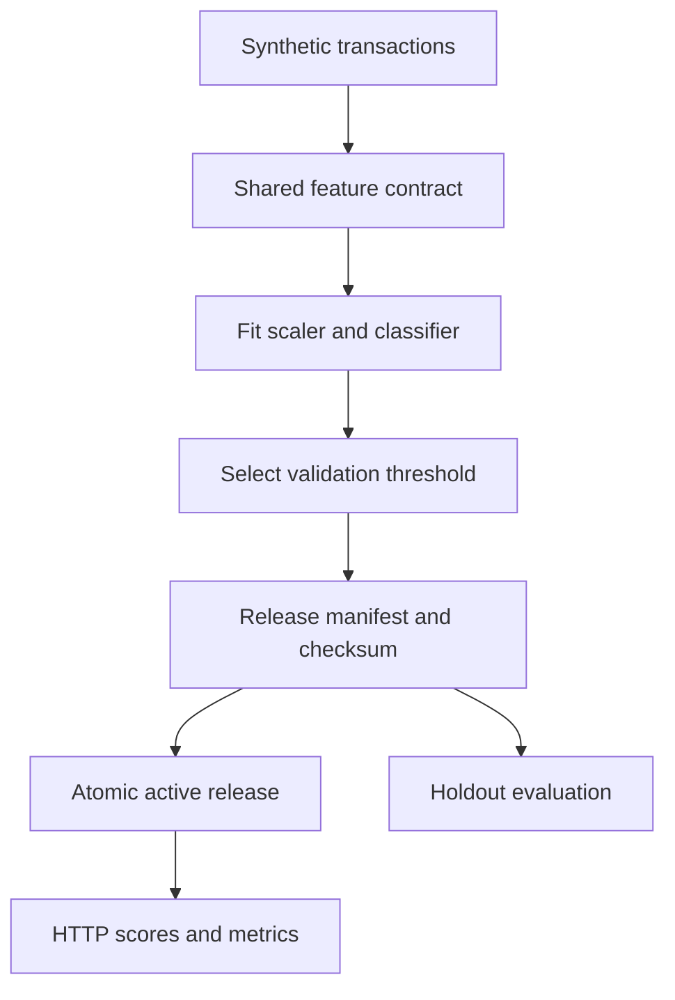

# Fraud model delivery and monitoring

**Which payments should enter a limited review queue?** A review team has limited capacity. This project trains a risk model, chooses a review threshold within a validation budget, packages an identifiable release, serves scores and exercises rollback.

On an 800-transaction synthetic holdout, the service flagged 59 transactions. Four were simulated frauds, 55 were false positives and 18 frauds were missed. Average precision was 0.070 against a prevalence baseline of 0.0275. The simulated cost was €10,100 versus €11,000 for always allowing. **The low recall is central to the release discussion.**

## Try it locally

Use Python 3.12 from the repository root. The demo generates its own synthetic inputs in a temporary directory and prints a decision readout.

```powershell
py -3.12 -m venv .venv
.\.venv\Scripts\python.exe -m pip install ".[dev]"
.\.venv\Scripts\python.exe scripts/demo.py
.\.venv\Scripts\python.exe -m unittest discover -s tests -v
```

On Linux or macOS, use `python3.12 -m venv .venv` and `.venv/bin/python` for the remaining commands. For the persistent example below, activate the environment first with `.\.venv\Scripts\Activate.ps1` in PowerShell or `source .venv/bin/activate` in Bash.

## Persistent example

```shell
fraud-train --output artifacts --rows 4000 --seed 42
python -m uvicorn fraud_platform.api:app --port 8080
```

With the service running, score a synthetic payment from PowerShell.

```powershell
$payment = @{transaction_id='demo-1'; amount_eur=251.5; merchant_risk=0.8; hour_utc=2; card_age_days=30; transactions_24h=9; ip_country_matches_billing=$false}
Invoke-RestMethod http://127.0.0.1:8080/v1/score -Method Post -ContentType application/json -Body ($payment | ConvertTo-Json)
```

The reference run returned `review`, a score of 0.124 and a threshold of 0.0521. The response includes the release ID. [Training evaluation](docs/training-report.json) · [Local request and latency results](docs/verification.txt)

## Architecture and methodology



Split 4,000 seeded independent observations 60/20/20 with stratification. Fit a scaler and logistic regression on training. Search validation score thresholds plus the always-allow threshold, minimizing €500 per miss and €20 per false alert subject to a 10% validation review cap. Evaluate the fixed rule once on test. The manifest records split counts, standardized coefficients and error counts. The 10% constraint is a calibration-set rule, so live arrival bursts may exceed capacity.

Scikit-learn shares the same feature mapper between training and API. FastAPI enforces the transaction contract. A filesystem registry demonstrates immutable releases and promotion on one host. Prometheus counters and latency histograms expose service behavior.

## Verification and operations

7 automated tests passed locally. The standalone demo ran twice with matching decision outputs. The HTTP smoke test also exercised a running server on a loopback TCP port. The repository includes a GitHub Actions workflow and Docker configuration. Hosted CI and container execution are pending.

For versioned service startup in PowerShell, use `$version = fraud-registry register --rows 4000 --seed 42`, then `fraud-registry promote $version`, then `$env:MODEL_REGISTRY = "artifacts/registry"`. Restart the service after changing the active version. Keep the previous release ID. To roll back, promote that ID and restart. Readiness returns 503 before a model loads. Score requests and readiness are exercised over loopback in the verification log.

## Limitations and next release

Synthetic labels encode a fixed stochastic rule. The holdout contains only 22 positive cases. A checksum verifies integrity relative to the manifest. Restrict write access to both artifacts and manifests because joblib deserializes trusted Python objects.

Establish the cost comparator, lock the feature contract, exercise promotion and rollback, then run a labeled shadow trial. Before a pilot, replace the independent split with a time- and entity-aware evaluation and rehearse a capacity alert.

[Product requirements, architecture decision and runbook](docs/design.md) · [Example output](docs/example.json) · [Executed commands and results](docs/verification.txt) · [Interview walkthrough](docs/interview.md)
